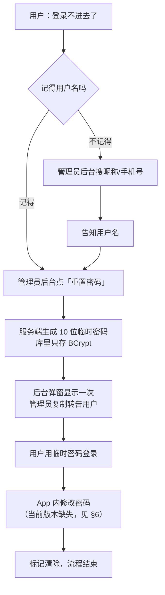

# 密码找回与管理员重置
>
> 适用版本：引入 `t_user.must_change_password` 之后的版本。
> 涉及三端：后端（Spring Boot）、管理后台（Vue + Element Plus）、App（Android）。

## 1. 结论先说

这台部署**没有任何邮件 / 短信通道**，注册时也不采集手机号与邮箱（`RegisterRequest` 只有用户名、密码、昵称），
因此**做不到自助找回**——没有可以用来证明「你是你」的东西。

现在提供的是**人工找回**：

| 忘了什么 | 谁来处理 | 怎么处理 |
| --- | --- | --- |
| 用户名 | 管理员 | 后台用户列表用**昵称 / 手机号**搜索，查到后告知用户 |
| 密码 | 管理员 | 后台「重置密码」→ 生成一次性临时密码 → 转告用户 |
| 管理员自己的密码 | 运维 | 只能改库（见 §8），因为管理员账号不允许被重置 |

**重要：忘记密码不会丢账。** 账本数据在手机本地，未登录也能记账；服务端数据按 `userId` 归属，重置密码不影响任何账本。
真正会丢数据的是「换手机 + 忘了密码」——那台新手机拉不回旧账号的数据。

## 2. 找回流程



注意顺序：**旧密码立即失效**，所以重置动作会影响正在使用该账号的所有设备（下一个请求被拒后需要重新登录）。

## 3. 接口

### 3.1 管理员重置用户密码

```http
POST /api/v1/admin/users/{id}/reset-password
Authorization: Bearer <管理员 accessToken>
```

无请求体。响应：

```json
{ "code": 0, "message": "ok", "data": "Xk3mPq7Rt2" }
```

`data` 就是临时密码，**只此一次**：服务端不保存明文、不打日志，关掉弹窗就再也拿不到，只能再重置一次。

规则：

| 情况 | 结果 |
| --- | --- |
| 目标不存在 | 404 `USER_NOT_FOUND` |
| 目标是 ADMIN | 400「不能重置管理员账号的密码，请用该账号登录后自行修改」 |
| 其他 | 密码更新为临时密码，`must_change_password = 1` |

### 3.2 用户修改自己的密码（本次新增，此前不存在）

```http
POST /api/v1/auth/password
Authorization: Bearer <用户 accessToken>
Content-Type: application/json

{ "oldPassword": "临时密码", "newPassword": "新密码" }
```

- 校验原密码，错误返回「原密码不正确」；
- 新旧相同会拒绝；
- 成功后 `must_change_password` 归 0。

### 3.3 登录响应里的新字段

`UserVO` 增加 `mustChangePassword`（0/1），登录、`/auth/me`、后台用户列表都会返回。
App 端据此提示「密码已被重置，请尽快修改」。

## 4. 管理后台操作

1. 登录后台 → **用户管理**；
2. 找到目标用户（可按用户名 / 昵称 / 手机号搜索）；
3. 操作列点 **重置密码** → 确认框会写明「旧密码立即失效」；
4. 弹窗显示 10 位临时密码，点「复制」，**通过可靠渠道**交给用户；
5. 关掉弹窗后明文不再可见；用户改完密码前，状态列会一直显示 **待改密** 标签。

## 5. 安全设计说明

| 决策 | 原因 |
| --- | --- |
| 临时密码由服务端生成，不是管理员自己填 | 管理员不掌握用户长期密码；避免「管理员设一个自己记得的密码」 |
| 10 位、`SecureRandom`、去掉 `0/O/1/l/I` | 口头/微信转达不易听错；密码在用户改密前就是这套账号的唯一凭据，不能用可预测随机 |
| 明文只返回一次，库中只存 BCrypt | 数据库或备份泄漏也拿不到可用密码 |
| 日志只记「谁重置了谁」 | 日志会被转发、归档，比数据库更容易泄漏 |
| 不允许重置 ADMIN | 否则一个被攻破的管理员账号可以顺走其他管理员 |
| 不阻止被重置的账号登录 | 拦在登录口的话，用户拿着临时密码也进不去改密码 |
| 重置后标记 `must_change_password` | 给 App / 后台一个可展示的信号，而不是靠口头提醒 |

### 已知限制

1. **旧 token 不会失效**。JWT 无版本号，access 默认 2 小时、refresh 7 天，重置密码后旧设备仍可用到过期。
   怀疑账号被盗时，重置密码后还要在后台 **禁用** 该账号。
2. **App 内暂无修改密码入口**（见 §6），临时密码目前改不掉。

## 6. 未完成项：App 端

当前 Android App 里没有「修改密码」的任何入口，因此：

- 用户拿到临时密码后**无法自行修改**；
- `mustChangePassword = 1` 这个标记目前只有后台能看到，App 不提示。

补齐这一环需要（约半天）：

1. `ApiService` 增加 `POST auth/password`；
2. `SettingsStore` 记住登录返回的 `mustChangePassword`；
3. 设置页加「修改密码」（原密码 + 新密码 + 确认）；
4. 标记为 1 时，进入首页弹一次提示并直达改密码。

在补齐之前，管理员重置密码后应**口头要求用户找时间改密**——否则这个临时密码会长期有效。

## 7. 数据库变更

```sql
ALTER TABLE t_user ADD COLUMN IF NOT EXISTS must_change_password SMALLINT NOT NULL DEFAULT 0;
COMMENT ON COLUMN t_user.must_change_password IS '1=密码已被管理员重置，提示用户登录后自行修改';
```

写在 `server/jizhang-api/src/main/resources/db/schema.sql`，开发与生产配置都是：

```yaml
spring.sql.init.mode: always
spring.sql.init.schema-locations: classpath:db/schema.sql
```

即**启动时自动执行、幂等**，部署新 jar 后无需手工迁移。历史数据默认 0，行为不变。

## 8. 管理员自己忘了密码

管理员账号不允许被重置，只能直接改库（BCrypt 哈希，不能用明文）：

```bash
# 生成哈希（任选其一）
htpasswd -bnBC 10 "" '新密码' | tr -d ':\n'
python3 -c "import bcrypt;print(bcrypt.hashpw(b'新密码', bcrypt.gensalt(10)).decode())"

# 写库
psql -U jizhang -d jizhang -c \
  "UPDATE t_user SET password='\$2a\$10\$<哈希>' WHERE username='admin' AND deleted=0;"
```

默认管理员是 `admin / admin123456`（`AdminAccountInitializer` 只在 `admin` 不存在时创建），生产环境务必第一时间改掉。

## 9. 验收清单

部署后按顺序过一遍：

- [ ] 服务启动无报错，`t_user` 已有 `must_change_password` 列；
- [ ] 后台用户列表出现「重置密码」按钮，「待改密」标签按需显示；
- [ ] 重置普通用户 → 拿到 10 位临时密码；用旧密码登录失败，用新密码成功；
- [ ] 重置 ADMIN 被拒绝，提示文案正确；
- [ ] `POST /api/v1/auth/password` 用临时密码改密成功，之后 `mustChangePassword = 0`；
- [ ] 未登录调用 `/auth/password` 返回 401。

快速自测（把 `BASE` / `TOKEN` 换成实际值）：

```bash
# 重置
curl -s -X POST "$BASE/admin/users/$UID/reset-password" -H "Authorization: Bearer $ADMIN_TOKEN"

# 用临时密码登录
curl -s -X POST "$BASE/auth/login" -H 'Content-Type: application/json' \
     -d '{"username":"demo","password":"<临时密码>"}'
```

## 10. 以后可以做得更好

| 方案 | 成本 | 取舍 |
| --- | --- | --- |
| 恢复码（注册时生成一次，用户自存） | 小，零外部依赖 | **推荐**：不采集隐私，用户丢了恢复码仍需人工介入 |
| 手机号 + 短信验证码 | 中，需要短信服务与合规 | 体验最好，但要存手机号 |
| 邮箱 + 邮件验证码 | 中，需要 SMTP | 自托管最现实的一条自助通道 |

无论走哪条，都建议先把 §6 的 App 内改密码补上——否则任何找回流程的最后一步都落不了地。
